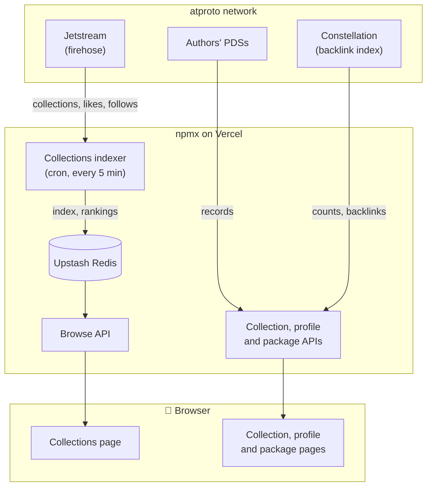

# Package collections on atproto

Status: draft, 2026-11-11.

Supersedes the sketch in [#78](https://github.com/npmx-dev/npmx.dev/issues/78). Also covers
[#2890](https://github.com/npmx-dev/npmx.dev/issues/2890) and the collection parts of
[#951](https://github.com/npmx-dev/npmx.dev/issues/951) and
[#2124](https://github.com/npmx-dev/npmx.dev/issues/2124).

## Thesis

Anyone can make a package collection on any PDS with any client. If the record uses our
lexicon, it shows up on npmx.dev. npmx.dev is one editor and viewer among many, not the
system of record. We support third-party writers and readers from day one, and we treat
every record as untrusted input.

## Goals

- Curated, ordered, annotated lists of npm packages, stored in the author's atproto repo.
- Likes and follows on collections.
- Discovery on profiles, on package pages and on the Collections page (`/collections`), which
  lists collections from all accounts, sorted by recent, most liked or most followed.
- Collections that include other collections.
- No npmx-run index on the read path for one user's collections.

## Non-goals (v1)

- Bookmarks ([#80](https://github.com/npmx-dev/npmx.dev/issues/80)). Bookmarks are an
  unbounded and possibly private set. They belong with the separate question of where
  private user settings live.
- Collections with more than one writer. An atproto record has one owner.
- Flattened or installable views of nested collections.
- Versions. Items reference packages, not package versions.

## Architecture

Data flows down to the browser. Writes, not shown, go from npmx.dev's server to the
author's PDS.



## Data model

### `dev.npmx.collection`

One record per collection, with the items inline. The record key is a TID.

```
name         string   maxGraphemes 64   maxLength 640    required
description  string   maxGraphemes 300  maxLength 3000
items        array    maxLength 1000                      required
  item (object)
    subjectRef  string  format uri        maxLength 300    required
    note        string  maxGraphemes 140  maxLength 560
createdAt    datetime                                     required
```

Only `name`, `items`, `createdAt` and `item.subjectRef` are required. Lexicon evolution rules
don't allow a required field to become optional later, so every other field is optional
from the start. `item` is an object, not a bare string, so items can get more fields later.

The NSID is `dev.npmx.collection`, not `dev.npmx.feed.collection`. In `app.bsky`, `feed.*`
is content, `graph.*` is relationships and `actor.*` is profiles. A package collection is
none of these.

### Why one record, not `collection` + `collection.item`

The lexicon style guide doesn't recommend either shape. Existing apps point to one record:

- Bluesky uses `app.bsky.graph.list` + `listitem` for unbounded membership sets, such as
  moderation lists with thousands of DIDs. Collections are bounded.
- grain.social stores galleries and photos as separate records, because photos are large
  blobs that people like individually. Our items are a URI and a short note.
- plyr.fm stores a playlist as one record with an ordered `items[]` of refs. That is the
  same shape as ours.

One record gives us order without extra work, one `getRecord` per view, and the simplest
format for third-party writers. The cost is that every edit is a read-modify-write.
Third-party writers should use `putRecord` with `swapRecord` so they don't overwrite a
concurrent edit.

A typical collection is a few KB. 1000 items with no notes is about 60 KB. Notes are capped
at 560 bytes instead of the usual 1400 for a 140-grapheme field, so a record with 1000 full
notes still fits under the 1 MB record limit. The item cap is 1000, not lower, because
collections also serve as follow lists, which are larger. A view resolves only its own
items, so the item cap also limits the work per view.

### `item.subjectRef`

`format: uri`, in one of two forms:

- A package: `https://npmx.dev/package/<name>`. This is the same string that
  `dev.npmx.feed.like` uses (`PACKAGE_SUBJECT_REF`). It identifies the package on the
  network. Readers don't need npmx.dev to be up to use it. Reusing the like identifier keeps
  one identifier per package. `<name>` is the name as published, not URL-encoded, because
  Constellation matches strings exactly.
- Another collection, by at-uri: `at://did:plc:.../dev.npmx.collection/<tid>`.

The lexicon description lists both forms. It tells consumers to show any other value as
unresolvable instead of rejecting the whole collection.

### Likes on collections

Collections reuse `dev.npmx.feed.like`. Its `subjectRef` field is a URI, so it can hold a
collection's at-uri as well as a package URL:

```
dev.npmx.feed.like { subjectRef: "at://did:plc:.../dev.npmx.collection/3abc...", createdAt }
```

The like record also has a `subject` field, which points at one exact version of a record.
We don't use it for collections: each edit creates a new version, so likes pinned to the old
one would stop counting. Bluesky likes posts this way because posts can't be edited.

The like lexicon's schema doesn't change. We only update its descriptions to mention
collections.

### Follows

A follow is `dev.npmx.graph.follow { subject: at-uri, createdAt }`, modeled on
`app.bsky.graph.follow`. A like tells other people that a collection is good. A follow means
you want updates about it. This is the same split as GitHub's star and watch.

- You can follow only collections. To follow a package, add it to a collection you follow.
  So there is no package follow record.
- Your own collections count as followed. We compute this; there is no follow record.
- `subject` accepts any at-uri, so we can allow following accounts or other subjects later
  without a schema change.
- Follower counts come from Constellation. The index behind the Collections page ranks the
  most-followed collections.
- A feed and notifications will use follows later.

### Nested collections

A `subjectRef` can point at another collection, so nesting needs no extra schema. For
example, "Vite ecosystem" can include the Vite team's own collection and a community
plugins collection that someone else curates. The owner adds the include once, and the
other curator maintains it from then on. This partly covers the case of collections with
several maintainers.

npmx.dev doesn't expand an included collection inline. It shows a summary (name, author,
item count) that links to the collection's own page, for example "Also includes: Vue
plugins by @x, 14 packages". The include is live, so readers need to see who curates each
part. Because we don't expand, a view does work only for its own items. We need no depth
limit, cycle detection or expansion budget. An include that is unresolvable, deleted or
hidden shows as a placeholder.

The lexicon description still tells consumers that expand inline to stop at 2 levels and to
detect cycles.

## Reads

Every read validates the record against the lexicon, and a record that fails is ignored. An
item whose `subjectRef` is a valid URI but neither a package nor a collection shows as
unresolvable.

| View                                     | Source                                                                                    | Infra             |
| ---------------------------------------- | ----------------------------------------------------------------------------------------- | ----------------- |
| Profile → Collections                    | `listRecords` on the author's PDS, resolved via `resolveMiniDoc` (same as `getUserLikes`) | none              |
| Collection page                          | `getRecord` on the author's PDS                                                           | none              |
| Package page → "in N collections"        | Constellation backlinks, `dev.npmx.collection:items[].subjectRef`                         | Constellation     |
| Collection → "included in N collections" | same source, target is the collection at-uri                                              | Constellation     |
| Like count, "you liked"                  | Constellation, `dev.npmx.feed.like:subjectRef`, target is the at-uri                      | Constellation     |
| Follower count, "you follow"             | Constellation, `dev.npmx.graph.follow:subject`, target is the at-uri                      | Constellation     |
| Collections page (`/collections`)        | the index below                                                                           | Jetstream + Redis |

Constellation indexes paths inside arrays. Its lag is a few seconds, the same as for likes. Your own profile reads your PDS directly, so you see
your own edits immediately.

An item that doesn't resolve to a package (a typo, an unpublished name, spam) shows greyed
out with its raw value. We don't drop it, and it doesn't break the collection. The author
must see it to fix it.

All collections are public, because atproto has no private records and no drafts. The editor
tells the user this.

The URL `/collections/<handle>/<rkey>` maps one-to-one to the at-uri. So a collection that
any client writes on any PDS has an npmx.dev URL immediately.

## Writes

Writes go through the server with the user's OAuth session. They need two new scopes:
`repo:dev.npmx.collection` and `repo:dev.npmx.graph.follow`. Existing users must consent
again.

Every collection page has a Duplicate button. It opens the new-collection editor, prefilled
with that collection's name, description and items. Saving creates a new collection in
your own repo. In v1, the copy doesn't store a reference to the original. An optional
`forkedFrom` field could add that later without a breaking change.

## Listening to the firehose

Until now, npmx has avoided consuming the firehose. Every social feature reads from the
author's PDS or from Constellation. The Collections page breaks that model, so npmx must
now consume the firehose and keep its own index.

The Collections page needs a list of every `dev.npmx.collection`, with rankings, and
nothing on the network provides one. The relay's `com.atproto.sync.listReposByCollection`
lists the accounts that have collections, but reading every one of their repos per page view
doesn't scale. Constellation answers "what points at X" only when you already know X. Likes don't help either, because to count the likes on a
collection you need its at-uri first. Without this page, the feature has no entry point.

We consume the firehose through Jetstream, filtered to our collections (see
"Architecture"):

- A Vercel Cron Job (`nitro.vercel.config.crons`) calls `/api/cron/collections-index` with
  `CRON_SECRET` every 5 minutes. We can't use Nitro's `scheduledTasks`, because it runs
  only on long-lived servers and not with the Vercel preset.
- We cap each run at 180 s, under Vercel's 300 s function timeout and the 5-minute cron
  interval. Runs overlap only if the cron fires twice, and the worst case is a stale entry.
  Replay processes about an hour of history per second, so one run can replay all of
  Jetstream's ~36-hour retention.
- Each run reads the cursor (a Jetstream `seq`) from Upstash, and connects to Jetstream v2
  (`jetstream.us-east.bsky.network`) with one `collections` parameter each for
  `dev.npmx.collection`, `dev.npmx.feed.like` and `dev.npmx.graph.follow`, and `kinds` set
  to `commit` and `identity`. It reads until it is caught up, writes the cursor and exits.
- We subscribe to identity events (~15/min) only as a clock. During replay, Jetstream scans
  on the server and sends nothing until an event matches. Without a steady event stream, we
  can't tell "caught up" from "still scanning".
- Volume is very low. Package likes, the closest existing signal, arrive a few times per
  day. We expect collections, likes and follows to grow by at most an order of magnitude
  beyond that in the near term.
- The Redis index stores an entry per collection, plus sorted sets for recent, most liked
  and most followed. Rankings count distinct accounts, and only for collections already in
  the index, so repeated records and made-up URIs can't inflate them. New accounts can; at
  our scale, we accept that and rely on moderation.
- Jetstream keeps about 36 hours of events. After a longer outage it rejects our cursor
  (HTTP 400 `CursorTooOld`), and the next run starts over from 35 hours back. Events before
  that are lost. That is acceptable, because the PDS is the source of truth and the index
  only helps discovery. Fast follow: a reconcile that lists accounts with
  `listReposByCollection` and reads their collections.

The indexer already receives every `dev.npmx.feed.like`, including likes on packages. So it
could also rank packages by likes, and the likes leaderboard could move off the separately
hosted [npmx-likes-leaderboard](https://tangled.org/baileytownsend.dev/npmx-likes-leaderboard)
service and onto our own index.

### Cost

On Vercel Pro, the indexer typically costs about $1 a month, and about $10 at worst. The
cron fires about 8,600 times a month, so invocations cost under a cent. A run mostly waits
on the socket, so it uses little CPU, but provisioned memory is billed for the whole run.
At the default 2 GB:

| Run length                            | Memory per month | Cost per month |
| ------------------------------------- | ---------------- | -------------- |
| ~10 s (typical; stops when caught up) | ~48 GB-h         | ~$0.50         |
| 180 s (every run hits the cap)        | ~864 GB-h        | ~$9            |

Active CPU adds about $0.30 a month. The indexer also sends Upstash Redis a few
hundred small commands a day.

On the read side, each package page view makes one extra request for its collection count,
the same as the existing like count. That's about $0.60 per million package page views. If
it matters, we can cache that response at the CDN or lower the cron function's memory.

## Moderation

npmx doesn't run a labeler, so v1 relies on Bluesky's.

The main abuse case is a collection such as "top crypto wallets" full of malicious packages.

- v1: hide collections whose author has Bluesky's `!hide`, `!takedown` or `spam` label,
  read from the Bluesky AppView (`app.bsky.actor.getProfiles`) when serving reads. Bluesky's
  moderators don't review `dev.npmx.*` records, so this misses accounts that only abuse
  npmx.
- Fast follow: an npmx-only denylist of at-uris and DIDs in Redis, applied on reads and in
  the index. Also a "report" button that posts to a Discord webhook or opens a GitHub issue.
  This protects only npmx.dev.
- Later: run Ozone. Labels on at-uris would then protect third-party consumers too.

## Curated collections

Collections from an allowlist of trusted accounts get a curated badge. The list starts with
the npmx account, and e18e is a candidate. The allowlist is our policy; nothing in the
record marks a collection as curated.

Curated collections can also replace hand-maintained category pages
([#2890](https://github.com/npmx-dev/npmx.dev/issues/2890)). For example, the npmx account
could publish "Test runners" or "Date libraries" as ordinary collections.

## Decisions log

- Package identity stays `https://npmx.dev/package/<name>`.
- One record with inline items. See "Why one record".
- `dev.npmx.collection`, not `dev.npmx.feed.collection`.
- Likes use the `subjectRef` at-uri, never the `subject` strongRef.
- Follows target only collections. To follow a package, add it to a collection you follow.
- Up to 1000 items, so collections can serve as follow lists.
- Nested collections are allowed. In v1 they're shown as linked summaries; flattened views
  may come later.
- Duplicates have no attribution.
- Bookmarks are out of scope.
- npmx consumes the firehose, via Jetstream, to index collections for the Collections
  page. This is in v1.

## References

- Issues: [#78](https://github.com/npmx-dev/npmx.dev/issues/78), [#80](https://github.com/npmx-dev/npmx.dev/issues/80), [#951](https://github.com/npmx-dev/npmx.dev/issues/951), [#1372](https://github.com/npmx-dev/npmx.dev/issues/1372), [#2124](https://github.com/npmx-dev/npmx.dev/issues/2124), [#2890](https://github.com/npmx-dev/npmx.dev/issues/2890).
- Figma `npmx-dev`: `main-profile-lists` (the profile Lists tab with Bluesky user lists; the
  closest existing card pattern) and `main-profile-likes`. There is no design for
  collections or bookmarks yet.
- [Lexicon style guide](https://atproto.com/guides/lexinomicon),
  [data validation guide](https://atproto.com/guides/data-validation),
  [pinned posts post-mortem](https://atproto.com/blog/pinned-posts),
  [Constellation](https://constellation.microcosm.blue/),
  [Jetstream replay](https://bsky.network/docs/jetstream-replay),
  [Nitro tasks](https://nitro.build/guide/tasks),
  [Nitro on Vercel](https://nitro.build/deploy/providers/vercel).
